# AWS Cloud Security: Root Account MFA Hardening & Identity Assurance

## Table of Contents
- [Introduction to Cloud Identity Hardening](#-introduction-to-cloud-identity-hardening)
- [Project Overview](#-project-overview)
- [Objective](#-objective)
- [System Specifications & Compliance Baseline](#️-system-specifications--compliance-baseline)
- [Authentication Architecture (ASCII Flowchart)](#-authentication-architecture)
- [Hardening & Deployment Methodology](#-hardening--deployment-methodology)
  - [Phase 1: Initial Root Access & Security Posture Assessment](#phase-1-initial-root-access--security-posture-assessment)
  - [Phase 2: MFA Hardware/Virtual Modality Selection](#phase-2-mfa-hardwarevirtual-modality-selection)
  - [Phase 3: Virtual TOTP Token Staging & Cryptographic Synchronization](#phase-3-virtual-totp-token-staging--cryptographic-synchronization)
  - [Phase 4: Device Assignment Validation & IAM Health Audit](#phase-4-device-assignment-validation--iam-health-audit)
  - [Phase 5: Out-of-Band Authentication Verification](#phase-5-out-of-band-authentication-verification)
- [Cloud Security Relevance & CIS Benchmark Impact](#-cloud-security-relevance--cis-benchmark-impact)
- [Ethical Guidelines & Disclaimer](#️-ethical-guidelines--disclaimer)

---

## Introduction to Cloud Identity Hardening
In Amazon Web Services (AWS), the **Root User** represents the apex identity of the tenant environment. Inheriting unconditional, non-revocable permissions across all control-plane APIs and data-plane resources, the root identity bypasses AWS Identity and Access Management (IAM) permission boundaries, service control policies (SCPs), and resource-based policies.

A compromised root credential grants an adversary complete ownership of cloud assets, enabling infrastructure termination, billing extortion, data exfiltration, and account hijacking. Enforcing **Multi-Factor Authentication (MFA)** on the root account establishes an essential out-of-band security barrier, requiring an adversary to possess both the primary secret (master password) and a physical or cryptographic token (RFC 6238 TOTP).

## Project Overview
This laboratory documents the complete operational hardening of an AWS Root user account using virtual Time-Based One-Time Password (TOTP) multi-factor authentication. Utilizing the **AWS Management Console**, **AWS IAM**, and **Google Authenticator**, this project walks through identity evaluation, cryptographic seed synchronization, verification testing, and compliance validation against established industry cloud benchmarks.

## Objective
To eliminate single-factor authentication risk on the root AWS account by provisioning a synchronized RFC 6238 virtual authenticator token. The implementation satisfies CIS AWS Foundations Benchmark Control 1.5, secures the management console against brute-force and credential-stuffing threats, and establishes proper operational hygiene for cloud tenant administration.

## System Specifications & Compliance Baseline
* **Cloud Infrastructure:** Amazon Web Services (AWS Global Infrastructure)
* **Target Identity:** Account Owner Root User (`root`)
* **Management Service:** AWS Identity and Access Management (IAM)
* **Authentication Standard:** RFC 6238 Time-Based One-Time Password Algorithm (TOTP)
* **Client Authenticator:** Google Authenticator (Android Engine)
* **Compliance Standards:**
  * CIS AWS Foundations Benchmark v3.0 (Control 1.5 - Ensure MFA is enabled for the 'root' user)
  * AWS Well-Architected Framework (Security Pillar - SEC 02: Protect identities)
  * NIST SP 800-63B (Authenticator Assurance Level 2 - AAL2)

---

## Authentication Architecture

```text
+---------------------------------------------------------------------------------+
|                       AWS ROOT MFA ENROLLMENT ARCHITECTURE                      |
+---------------------------------------------------------------------------------+

 [ AWS IAM Control Plane ]                             [ Out-of-Band Mobile Client ]
          |                                                         |
          |-- (1) Generates Shared Secret Seed -------------------->|
          |       (Rendered as QR Code / Base32)                    |
          |                                                         |
          |                                          +--------------v--------------+
          |                                          |   Google Authenticator App  |
          |                                          |  Stores HMAC Secret Key (K) |
          |                                          +--------------+--------------+
          |                                                         |
          |                                          (2) Calculates TOTP:
          |                                              T = (Current_Time - T0) / X
          |                                              Hash = HMAC-SHA1(K, T)
          |                                              Code = Dynamic Truncation
          |                                                         |
          |<-- (3) Receives Code 1 (Time Window T) -----------------|
          |                                                         |
          |<-- (4) Receives Code 2 (Time Window T + 30s) -----------|
          |                                                         |
 +--------v-----------------------------------+                     |
 | AWS IAM Token Synchronization Engine       |                     |
 | - Verifies Drift & Validates Rate Window   |                     |
 | - Persists Virtual MFA Serial (ARN)        |                     |
 +--------------------+-----------------------+                     |
                      |                                             |
                      v                                             |
      [ Root MFA Successfully Bound ]                               |
                      |                                             |
======================+=============================================+================
                      |
                      |          SUBSEQUENT SIGN-IN WORKFLOW
                      v
 [ AWS Console Login ]
          |
          +---> (1) Evaluates Primary Factor: Email + Password [Valid]
          |
          +---> (2) Triggers MFA Challenge Screen
          |           ^
          |           |
          |         (3) User Supplies 6-Digit Live Code from Authenticator
          |           |
          +---> (4) Cryptographic Verification Successful -> Full Access Granted
```

---

## Hardening & Deployment Methodology

### Phase 1: Initial Root Access & Security Posture Assessment

Initiated the administrative session by navigating to the AWS Management Console Sign-In portal (`signin.aws.amazon.com`)[cite: 89]. Selected the **Root user** authentication option and supplied the account owner root email address.
<br>

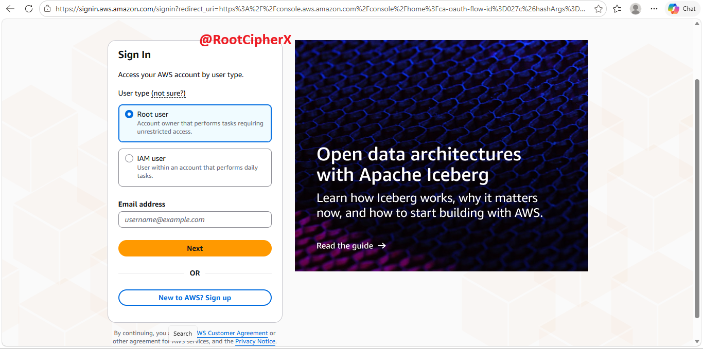

Supplied the root master password to satisfy the primary authentication factor.
<br>


Navigated to the global service locator and searched for **IAM** (Identity and Access Management) to audit security configurations.
<br>

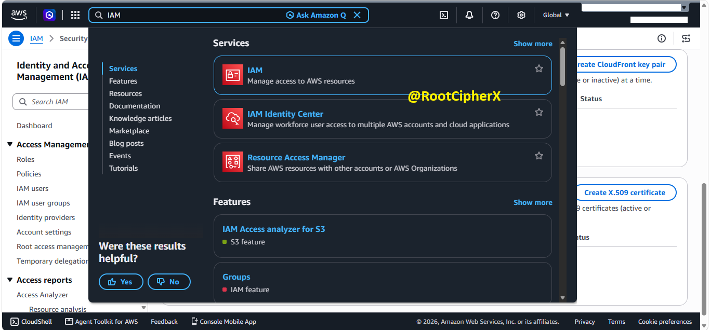

Inspected the **IAM Dashboard** overview. The console reported an active security posture alert:
* **Recommendation:** *"Add MFA for root user - Enable multi-factor authentication (MFA) for the root user to improve security for this account."*
* Selected **Add MFA** to launch the device association wizard.
<br>

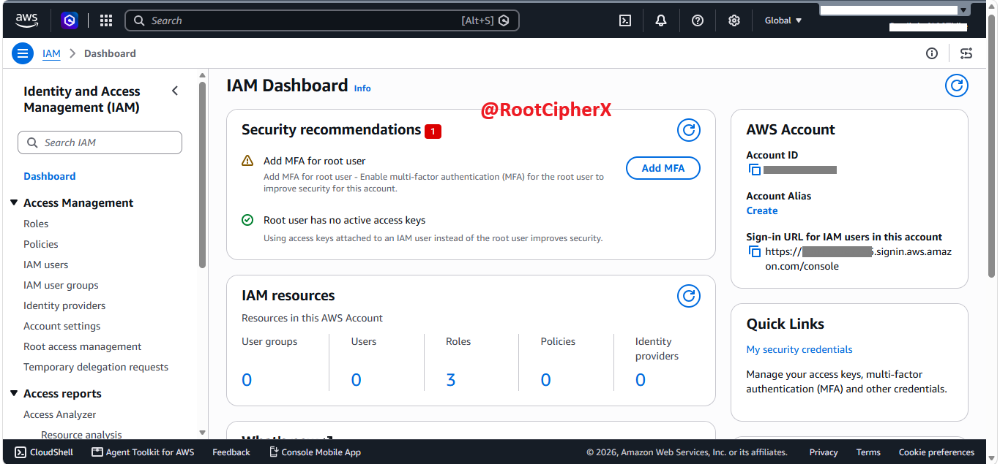

---

### Phase 2: MFA Hardware/Virtual Modality Selection

Initiated Step 1 (*Select MFA device*) within the enrollment console. Configured the unique identifier string for the authenticator entity within the **MFA device name** parameter.
<br>

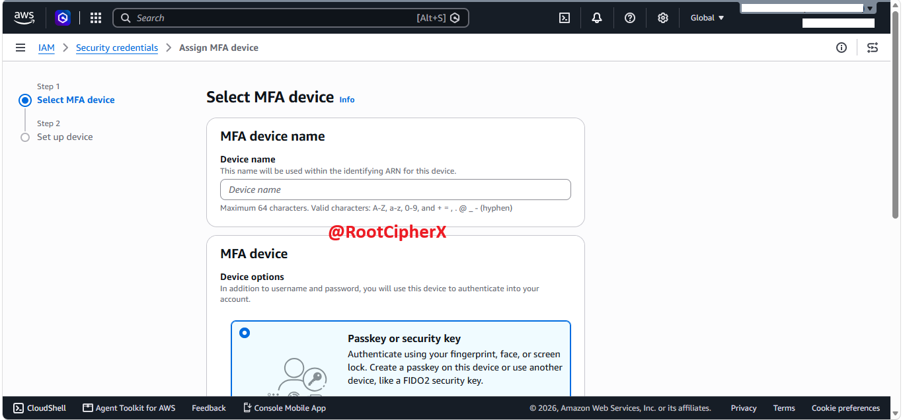

Evaluated the supported secondary factor device modalities:
* **Passkey or security key:** FIDO2 WebAuthn hardware tokens (e.g., YubiKey) providing physical non-repudiation and phishing resistance.
* **Authenticator app:** Software-based virtual tokens calculating RFC 6238 time-synchronized hash values.
* **Hardware TOTP token:** Standalone physical devices displaying time-based codes via built-in displays.
<br>

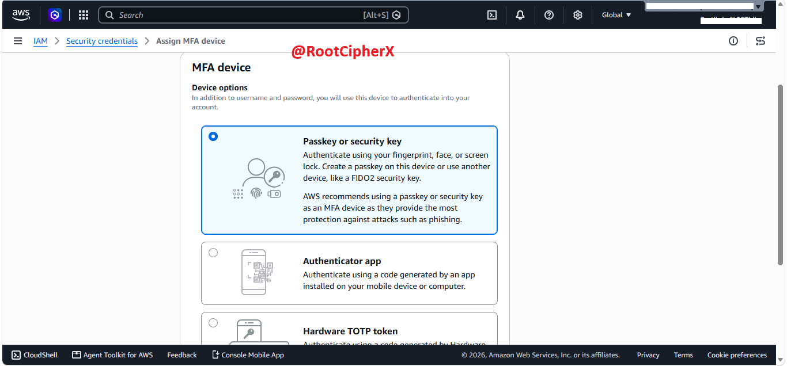

Selected the **Authenticator app** modality to establish mobile device-bound software verification.
<br>

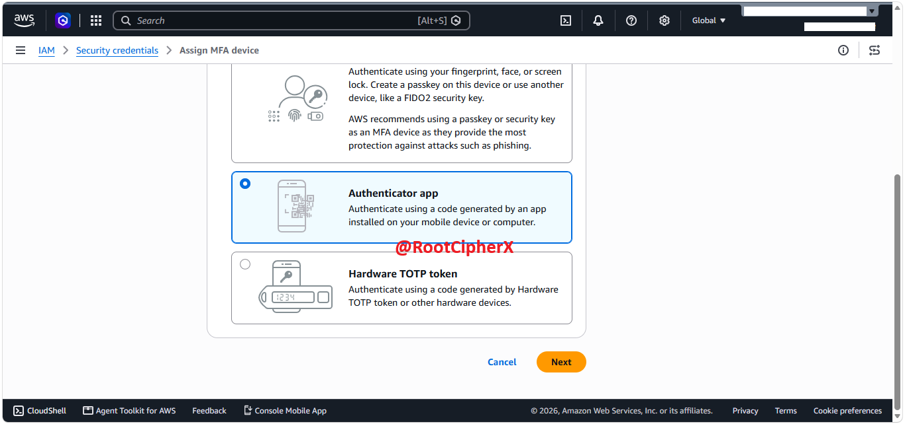

---

### Phase 3: Virtual TOTP Token Staging & Cryptographic Synchronization

Progressed to Step 2 (*Set up device*). AWS generated a dynamic, secret HMAC seed key encoded within an interactive QR code block. 

The wizard requires entering two consecutive 6-digit verification codes generated 30 seconds apart to prevent clock-drift failures and confirm hash synchronization.
<br>

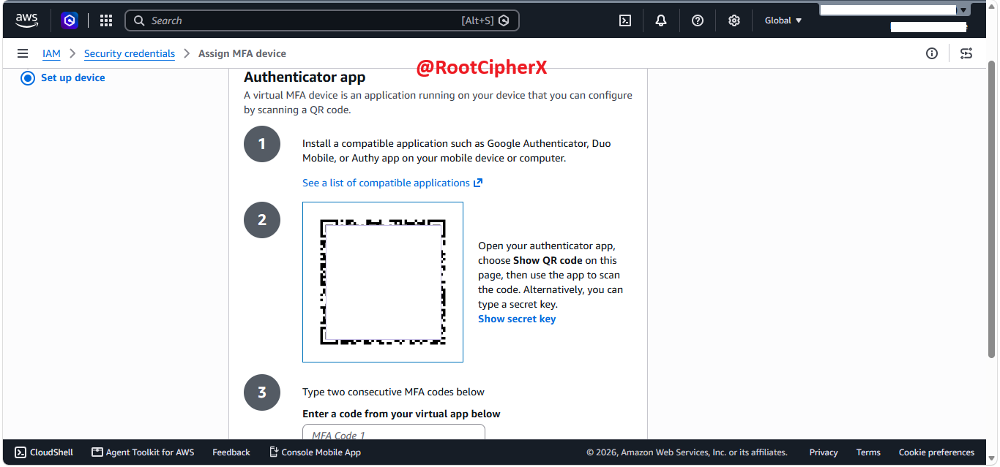

Switched to an external mobile device, accessed the Google Play Store, and searched for the official **Google Authenticator** application.
<br>

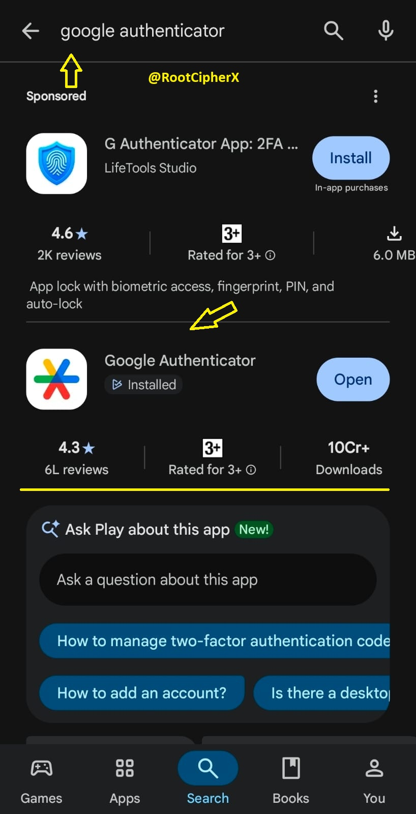

Installed and opened the application on the isolated device.
<br>

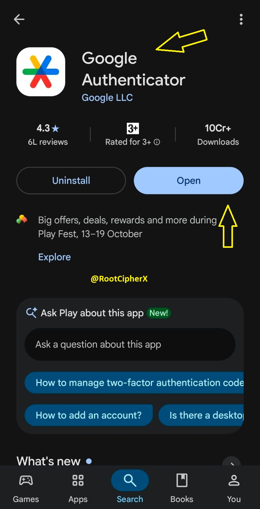

Selected the **Add Account (+)** button within Google Authenticator and selected **Scan a QR code** to capture the provisioning seed displayed on the AWS console.
<br>

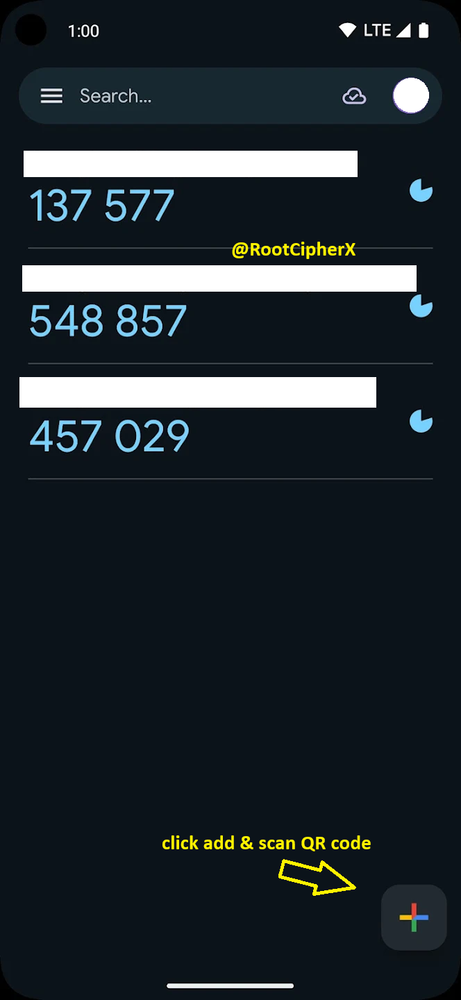

The application immediately instantiated a dynamic 30-second token generation loop. To satisfy the registration challenge, captured two sequential tokens:
* Captured **MFA Code 1** from the active window.
* Waited 30 seconds for the counter interval to rotate and captured **MFA Code 2**.
* Submitted both values and clicked **Add MFA**.
<br>

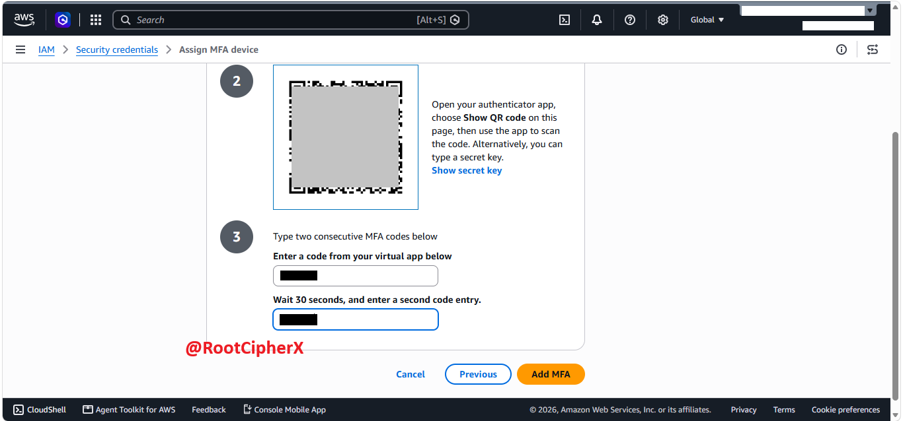

---

### Phase 4: Device Assignment Validation & IAM Health Audit

Upon submission, the console returned a positive confirmation banner:
> *"MFA device assigned. You can register up to 8 MFA devices of any combination of the currently supported MFA types with your AWS account root and IAM user."*
<br>

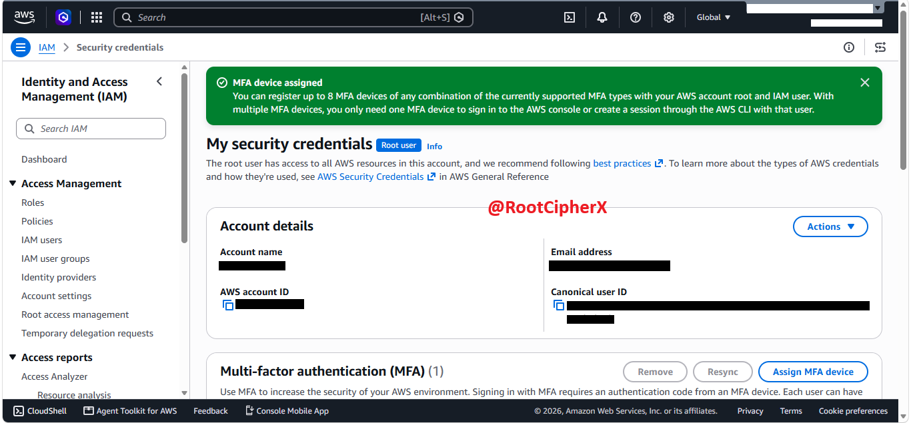

Audited the updated **Multi-factor authentication (MFA)** table within the root security credentials panel:
* **Type:** `Virtual`
* **Device Identifier:** Bound to the specific device ARN
* **Status:** Fully active and synchronized
<br>

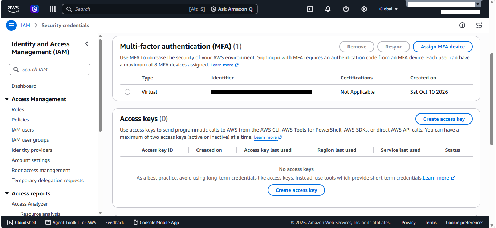

Returned to the master **IAM Dashboard** to verify overall tenant health:
* **Security recommendations:** Scaled from `1` alert down to `0`.
* **Root user has MFA:** Displayed a passing green validation indicator.
* **Root access keys:** Confirmed `0` active programmatic access keys, validating administrative least-privilege best practices.
<br>

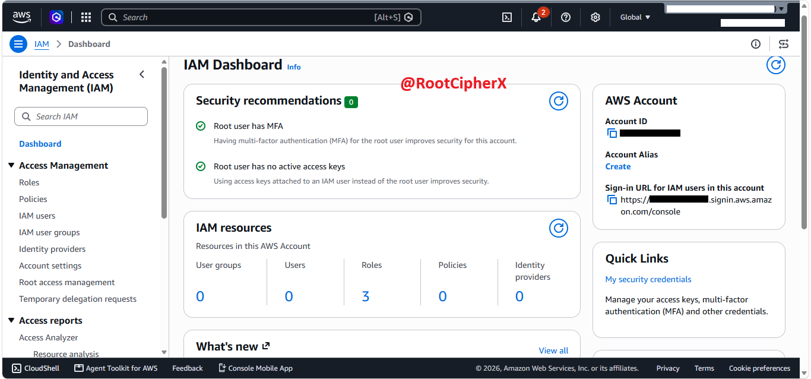

---

### Phase 5: Out-of-Band Authentication Verification

To confirm that two-factor enforcement was strictly gating console access, executed a full sign-out and initiated a new sign-in flow Selected **Root user** and entered the root account email address.
<br>

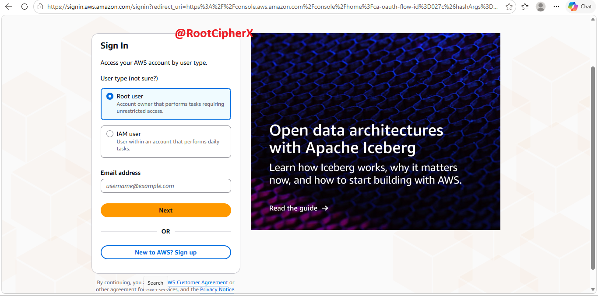

Supplied the root master password.
<br>

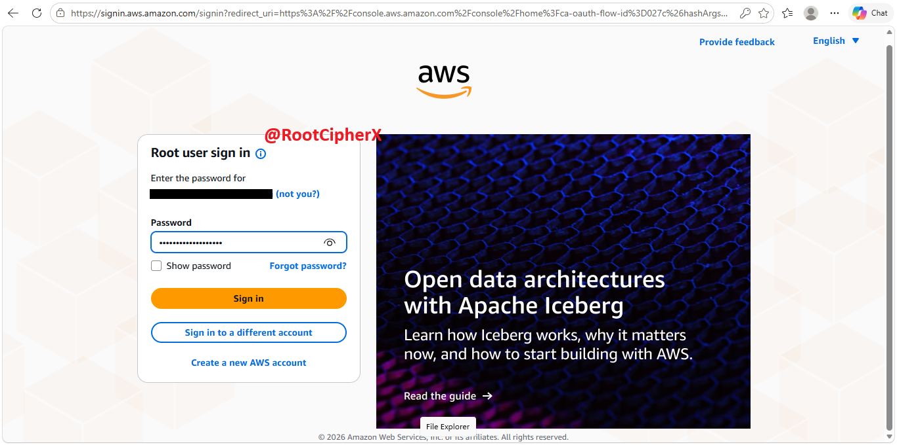

Upon validating the primary credential factor, AWS halted direct console authorization and redirected to the mandatory secondary authentication challenge:
> *"Additional verification required. Your account is protected with multi-factor authentication (MFA). To finish signing in, enter the code from your MFA device below."*
<br>

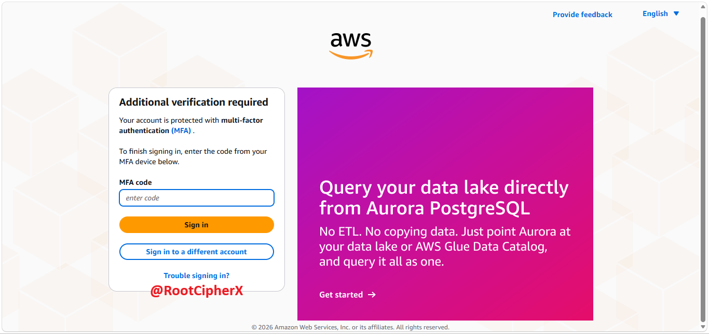

Retrieved the active 6-digit TOTP code from the mobile Google Authenticator app, entered the numerical string into the **MFA code** prompt, and selected **Sign in**. 

The console accepted the cryptographic proof and granted access to **Console Home**, confirming end-to-end enforcement.
<br>

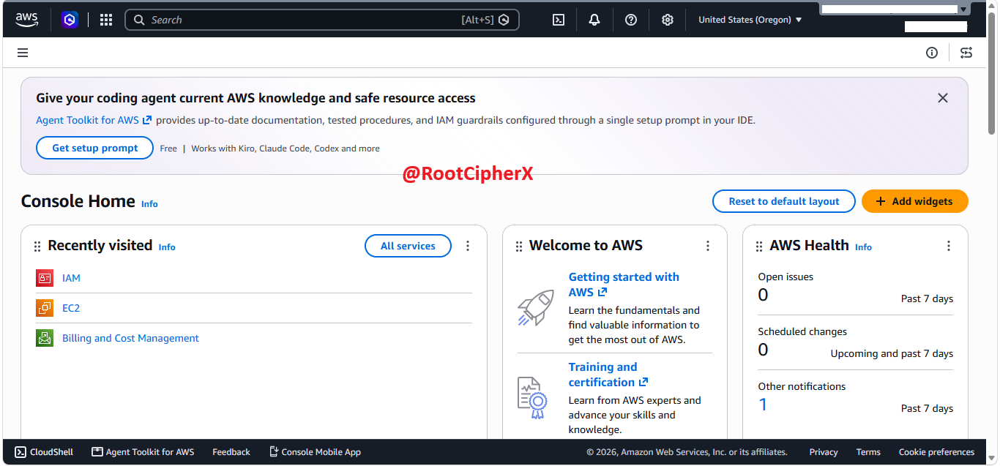

---

## Cloud Security Relevance & CIS Benchmark Impact

Enforcing multi-factor authentication on the root user is one of the highest-priority security controls in AWS:

* **CIS AWS Foundations Benchmark v3.0 (Control 1.5):** Mandates that multi-factor authentication be enabled on the root account. Failing this check represents an immediate high-severity compliance failure across SOC 2, ISO 27001, and FedRAMP audits.
* **Elimination of Password-Only Exposure:** Compromised master credentials obtained via infostealer malware, phishing, or credential stuffing cannot authorize console access without physical possession of the mobile token engine.
* **Separation of Factor Channels:** Using a separate mobile device provides true out-of-band factor isolation, ensuring an attacker compromising the administrator's desktop browser cannot intercept the secondary verification code.
* **Zero Programmatic Keys for Root:** Complementing MFA enforcement by maintaining zero active root access keys ensures that long-lived API secrets cannot bypass the console MFA gate[cite: 113, 114]. Daily tasks should instead be delegated to scoped IAM roles and IAM Identity Center (SSO) users.

---

## Ethical Guidelines & Disclaimer
This lab was completed within an authorized, privately owned Amazon Web Services account strictly for defensive engineering, cloud compliance validation, and identity security education. All sensitive account identifiers, email addresses, and cryptographic QR seed blocks have been redacted to demonstrate operational workflows while preserving tenant security.
